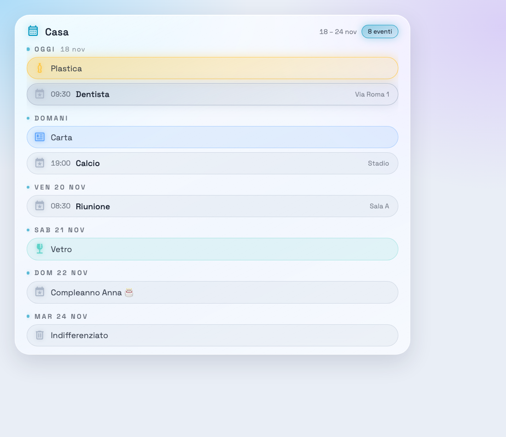

# Glass Calendar Card

<p align="center">
  <br><br>
  
</p>

A weekly calendar agenda for Home Assistant, in the same **liquid glass** style as the
[Glass Clock Weather Card](https://github.com/ironblaster/glass-clock-weather-card):
frosted backdrop blur, glow, color-coded events, dark/light auto mode — and a full
visual editor.

It replaces the stock `cal-card` with a card that fits a glass / "Casa Futura" look:

- Events of the next **1–14 days**, grouped by day (Today, Tomorrow, Tue 3 Feb, …)
- Each event is a pill in the same visual language as the calendar chips of the clock card:
  colored icon with glow, time, title, location
- Today's events glow a little stronger
- **Event types**: events whose title matches a pattern get their own label, icon and color
  (waste collection ready-made, in German, English and Italian)
- Standard tap / hold / double-tap actions
- Events are fetched through Home Assistant's own `calendars` API, cached for 15 minutes

## Install

### HACS

1. HACS → Dashboards (or Plugins, depending on your HACS version) → ⋮ → *Custom repositories*
2. Add `https://github.com/renewelches/glass-calendar-card`, type **Dashboard**
3. Install **Glass Calendar Card** and reload the browser

### Manual

Copy `dist/glass-calendar-card.js` into `config/www/`, add it to `configuration.yaml`:

```yaml
http:
  extra_config_url_paths:
    - /local
```

## Usage

```yaml
type: custom:glass-calendar-card
entity: calendar.waste
days: 7
max_events: 8
show_location: false
default_icon: mdi:calendar-star
calendar_types:
  - pattern: "Gelb|Plastik|Metall"
    label: "Gelber Sack"
    icon: mdi:bottle-soda-classic-outline
    color: [255, 198, 64]
  - pattern: "Papier|Blauer Sack"
    label: "Papier"
    icon: mdi:newspaper-variant-outline
    color: [96, 165, 250]
  - pattern: "Bio|Grün"
    label: "Bioabfall"
    icon: mdi:food-apple-outline
    color: [92, 210, 120]
  - pattern: "Glas"
    label: "Glas"
    icon: mdi:glass-fragile
    color: [92, 210, 200]
  - pattern: "Rest|Grauer Sack"
    label: "Restmüll"
    icon: mdi:trash-can-outline
    color: [170, 182, 200]
```

Everything can also be set in the visual editor: choose your calendar, add event types
(including one-click waste-collection examples), and tune the appearance to match the
clock card (accent color, font, glow, corner radius, …).

## Options

| Option | Type | Default | Description |
| ------ | ---- | ------- | ----------- |
| `entity` | entity | **required** | A `calendar.` entity. |
| `name` | text | from the entity | Card title in the header. |
| `show_header` | boolean | `true` | Title, week range and event count. |
| `days` | `1`–`14` | `7` | How many days from today are covered. |
| `max_events` | `1`–`50` | `8` | Maximum events shown per day. |
| `show_time` | boolean | `true` | Show the start time of timed events. |
| `show_location` | boolean | `false` | Show the event location, if it has one. |
| `default_icon` | icon | `mdi:calendar-star` | Icon for events without a matching type. |
| `default_color` | color | grey | Color for events without a matching type. |
| `calendar_types` | list | | Each item: `pattern`, `label`, `icon`, `color`. The pattern is searched in the event title case-insensitively; separate alternatives with `|`. |
| `appearance` | `auto`, `dark`, `light` | `auto` | `auto` follows the dark mode of your theme. |
| `font` | `space_grotesk`, `theme`, `custom` | `space_grotesk` | Same choices as the clock card, so both cards match. |
| `font_family` | text | | Font name, used with `font: custom`. |
| `text_scale` | `0.6`–`1.8` | `1` | Makes every text bigger or smaller. |
| `min_height` | pixels | `320` | Minimum height. In a sections view the grid sets the height instead. |
| `glass` | boolean | `true` | Glass background with blur. Off: the normal card background of your theme. |
| `glow` | `0`–`1` | `0.5` | Glow of the header icon and of today's events. |
| `border_radius` | pixels | `32` | Keep it the same as on the clock card to match. |
| `accent_color` | color | cyan | Header icon, day dots, event count badge. |
| `text_color` | color | white (dark), ink (light) | |
| `background_color` | color | | A tint over the glass. |
| `background_opacity` | `0`–`1` | `0.18` | Strength of the tint. |
| `tap_action` | action | more info of the calendar | Any standard Home Assistant action, e.g. `navigate` to the calendar page. |
| `hold_action` | action | none | |
| `double_tap_action` | action | none | |

Colors can be written as `[r, g, b]`, `"#rrggbb"` or `"r, g, b"`.

## Demo

The repo includes a small demo page (no Home Assistant required):

```
python3 -m http.server -d . 8080
# → http://localhost:8080/demo/?theme=light  or  ?lang=de  or  ?lang=it
```

## Privacy

All event data is served by your own Home Assistant instance; the card never talks to
the internet. With `font: space_grotesk` (the default) the font is loaded from Google
Fonts. Choose `font: theme` to avoid that.

## License

MIT
